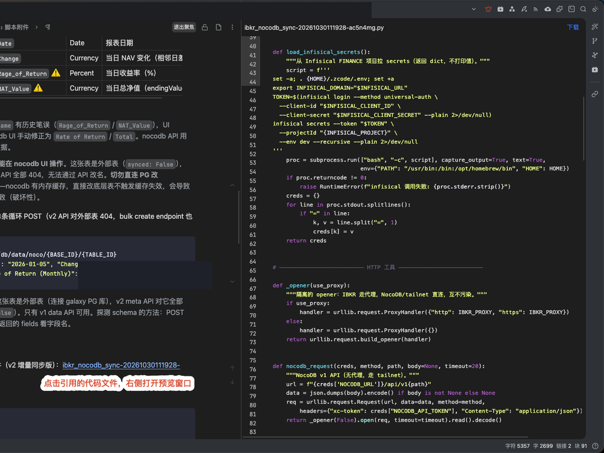

# Code Files 代码文件

[中文](./README.zh-CN.md)

Store code files as SiYuan assets, preview them with syntax highlighting and line numbers, reference them from notes with plain Markdown links, and expose them to AI agents — without embedding long code in `.sy` files. 中文名：代码文件。

## How it works

* **Store**: code files live in `data/assets/` through the normal kernel asset pipeline (upload, dedup, sync, history all inherited).
* **Reference**: notes hold a one-line `[name](assets/...)` link; documents stay clean.
* **Preview**: clicking a link opens a read-only tab with syntax highlighting, line numbers, and a download button, mirroring the official PDF behavior.
* **Manage**: the dock panel lists, creates, references, and deletes code files.
* **Expose**: the kernel plugin registers a `get_referenced_scripts` agent capability (also projected to external MCP clients), resolving a document's asset references and returning each file path with its content. The AI fetches files locally and runs them itself — this plugin never executes code.

## Development

* `pnpm i` to install dependencies
* `pnpm run dev` for real-time compilation
* `pnpm test` for unit tests, `pnpm run lint` / `pnpm run format` before committing
* `pnpm run build` produces `dist/` and `package.zip`

## Plugin files

* `src/index.ts`: frontend dock panel (list, create, insert reference, delete)
* `src/kernel.ts`: backend agent capability `get_referenced_scripts`
* `src/shared.ts`: script-extension conventions shared by both ends
